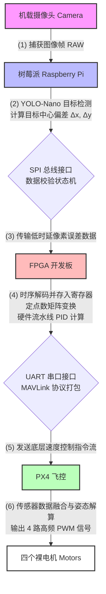

## 一、 完整系统硬件需求清单

### 1. 现有基础硬件

- **控制核心**：PX4 自动驾驶仪（飞控）。
- **计算外设**：树莓派、FPGA 开发板。
- **动力总成**：四轴机架、无刷电机 4个(其实还没有）、电调（ESC）（我也不知道有几个）、动力电池。

### 2. 必需补充硬件

- **视觉图像输入**：机载摄像头（低延迟、全局快门、USB 或 CSI 接口）。
- **供电分配系统**：大功率 BEC 稳压模块（5V/3A 2个，独立为树莓派和 FPGA 供电，禁止直接抽取飞控电量）。
- **物理连接介质**：高速排线、杜邦线（用于总线互连）、机载电脑专用硅胶减震球。

## 二、 核心技术难点与工程瓶颈

### 1. 物理层：载重、功耗与减震地狱

- **载重超标导致动力衰减**：树莓派（约 45g） + FPGA 开发板（约 50g-100g） + 飞控（约 40g） + 独立供电模块 + 错综复杂的接线。整机空载重量激增，导致电机升力冗余不足，动态响应变慢，极易引发起飞瞬间侧翻。
- **高频共振摧毁视觉识别**：四轴裸机无任何减震设计。电机高频旋转产生的机械振动直接传导至摄像头，引发“果冻效应”，导致 YOLO 图像模糊，识别率断崖式下跌。
- **功耗过高引发电压跌落**：树莓派高负载推理与 FPGA 并行计算瞬间电流极高。若供电纹波过大，将导致飞控重启或树莓派降频，直接引发空中断电炸机。

### 2. 通信层：跨平台异构总线对接

- **软硬件时序对齐（树莓派 ➔ FPGA）**：树莓派运行 Linux（非实时系统），FPGA 为硬实时。采用 SPI 传输目标像素误差（$\Delta x, \Delta y$）时，树莓派的系统调度延迟会导致 FPGA 读到空指针或错位数据，需在 Verilog 中设计严格的数据校验与缓存状态机。
- **二进制协议硬编码（FPGA ➔ PX4）**：若由 FPGA 直接控制飞行，需在 Verilog 中手写状态机，将控制量打包成标准的 **MAVLink 协议二进制数据流**，通过串口（UART）喂给 PX4 飞控。字符拼接错误将导致飞控直接拒绝执行命令。

### 3. 算法层：定点数运算与延迟发散

- **硬件 PID 浮点运算受限**：FPGA 缺乏原生浮点运算器。在 Verilog 中编写 PID 控制算法时，必须将像素误差全部转化为**定点数（Fixed-point）**，依靠移位操作和补码乘法器实现，极易发生数值溢出或精度缺失，导致控制信号失真。
- **算力瓶颈诱发控制发散**：树莓派纯 CPU 运行 YOLO 帧率极低（通常 $<10$ FPS）。**视觉推理延迟 + 总线传输延迟 + 控制器响应延迟 = 超大系统滞后**。无人机将无法对移动目标做出及时响应，并在追踪过程中产生大范围震荡。

## 三、 软硬件数据流向图

